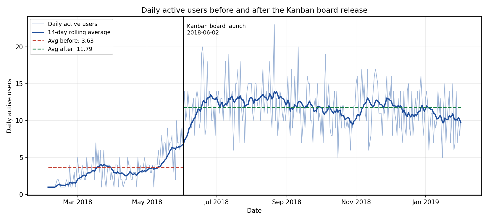
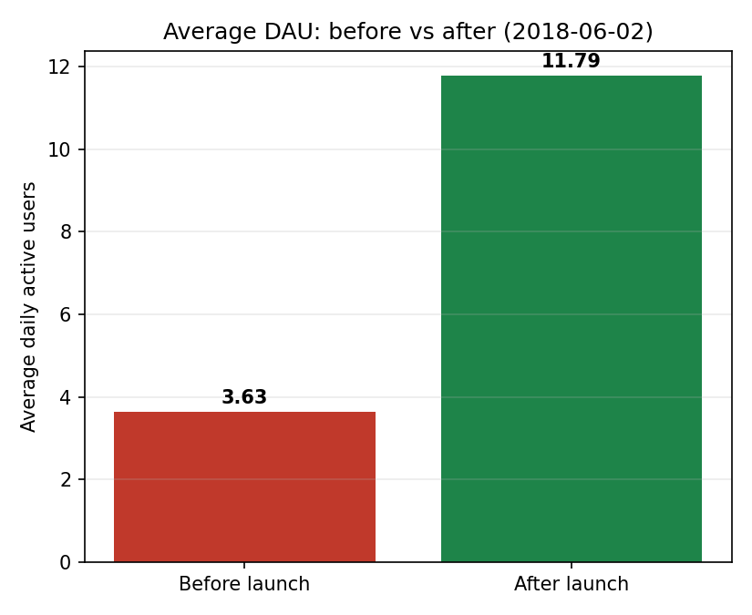
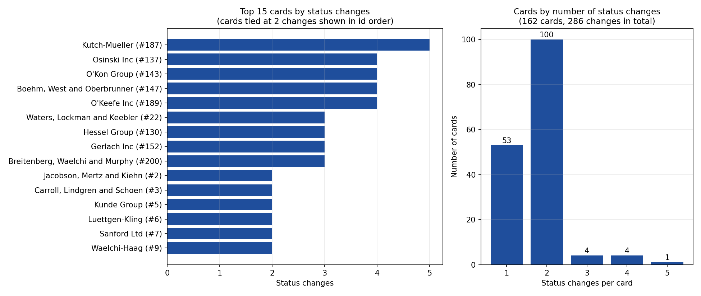

# Shiptivitas Analytics: Kanban Board Release (2018-06-02)

**Goal:** find ideas that move our core metric, daily active users (DAU).
**Data:** `shiptivity.db`, covering 2018-02-03 to 2019-02-01. Queries are in the SQL section below and in `answer.sql`.

---

## 1. Key findings

| Metric | Result |
|---|---|
| Average DAU **before** the Kanban release | **3.63** (110 days with logins) |
| Average DAU **after** the Kanban release | **11.79** (245 days) |
| Change | **+225%**, about 3.2x |
| Peak day | 23 users on 2018-08-21 |
| Cards with at least one status change | 162 cards, 286 status changes in total |
| Average status changes per card | 1.77 |

1. **The Kanban board lifted DAU by about 3x.** The daily average went from 3.63 to 11.79. Days with no logins are not rows in the data, so the "before" average is slightly overstated. Spread over all 119 calendar days before launch it is about 3.35, and the lift is still about 3.5x.
2. **Growth has stalled since the launch spike.** The monthly average was 11.9 in June, 12.9 in July and 12.8 in August, then drifted to 10.5 in October and 10.2 in January. DAU has not grown for 7 months.
3. **DAU started rising in May, before the launch.** The monthly average went from about 3 in March and April to 5.5 in May. That could be early access or beta users, so part of the lift may be attributable to pre-launch activity.
4. **Usage is flat across the week.** After the launch, the average is between 11.2 and 12.3 on every day of the week, with no weekday-vs-weekend gap. The board is used as a steady daily habit.
5. **Cards move through the board only once or twice.** 100 cards had exactly 2 status changes, 53 had only 1, and just 9 cards had 3 or more (maximum 5). The board is mostly used as a one-way pipeline, and 53 cards moved only once, so they may be stuck part-way.

---

## 2. Chart 1: Daily active users before and after the release



Average DAU before vs after:



| Period | Average DAU | Days |
|---|---|---|
| Before (up to 2018-06-01) | 3.63 | 110 |
| After (from 2018-06-02) | 11.79 | 245 |

---

## 3. Chart 2: Number of status changes by card



Status changes per card (all 162 cards):

| Status changes | Number of cards |
|---|---|
| 1 | 53 |
| 2 | 100 |
| 3 | 4 |
| 4 | 4 |
| 5 | 1 |

Top cards: Kutch-Mueller (#187) with 5, then Osinski Inc (#137), O'Kon Group (#143), Boehm, West and Oberbrunner (#147) and O'Keefe Inc (#189) with 4 each.

---

## 4. SQL queries

```sql
-- Query A: average daily active users before vs after the Kanban release
WITH daily AS (
  SELECT date(login_timestamp, 'unixepoch') AS day,
         COUNT(DISTINCT user_id)            AS dau
  FROM login_history
  GROUP BY day
)
SELECT CASE WHEN day < '2018-06-02' THEN 'before' ELSE 'after' END AS period,
       ROUND(AVG(dau), 2) AS avg_dau,
       COUNT(*)           AS days_in_period
FROM daily
GROUP BY period;

-- Query B: daily active users for every day
SELECT date(login_timestamp, 'unixepoch') AS day,
       COUNT(DISTINCT user_id)            AS daily_active_users
FROM login_history
GROUP BY day
ORDER BY day;

-- Query C: number of status changes by card (reorders inside a lane excluded)
SELECT c.id,
       c.name,
       COUNT(*) AS status_changes
FROM card_change_history h
JOIN card c ON c.id = h.cardId
WHERE h.oldStatus <> h.newStatus
GROUP BY c.id, c.name
ORDER BY status_changes DESC;
```

---

## 5. Three actionable ideas

The impact figures are estimates to be validated with an A/B test, not forecasts.

### Idea 1: Stale-card nudges

- **Hypothesis:** 53 of 162 cards moved only once, so many cards are probably sitting in a lane with no follow-up. If users are reminded about cards that have not moved for a few days, more cards will progress to Complete and users will have a reason to open the app.
- **Expected impact:** status changes per card up from 1.77 to about 2.0 (+15%), and DAU up about 5%.
- **What the feature is:** a "Stale" badge on cards that have sat in the same lane for 3 days, plus a short daily summary ("4 cards haven't moved this week") shown at the top of the board and sent by email.

### Idea 2: Daily digest for returning users

- **Hypothesis:** DAU has been flat or slowly declining since July (12.9 to about 10.2 in January). A daily message that shows what is waiting on the board will bring back users who have drifted away.
- **Expected impact:** recover about half of the decline, which is +1 to 2 DAU (about +10 to 15%) within two months.
- **What the feature is:** an opt-out daily email or push notification listing the user's cards in In Progress, plus a weekly "You completed N cards" progress summary.

### Idea 3: Assignees and shared boards

- **Hypothesis:** DAU is steady at about 12 and does not grow on its own. If each card can be assigned to a teammate who gets notified, each existing customer brings in more daily users.
- **Expected impact:** DAU up about 20% over the following quarter, if one in four active users invites a teammate. The data here does not show users per account, so this needs validation first.
- **What the feature is:** an "Assign to" field on every card, an invite-by-email link, and a notification when a card is assigned or moves lane.

### Wireframe sketch (Idea 1)

```
+------------------------------------------------------------+
|  Shiptivitas                    ! 4 cards haven't moved    |
+----------------+-------------------+-----------------------+
| Backlog        | In Progress       | Complete              |
| [Card A]       | [Card D] STALE 3d | [Card G]              |
| [Card B]       | [Card E]          | [Card H]              |
| [Card C]       | [Card F] STALE 5d |                       |
+----------------+-------------------+-----------------------+
```

---

## 6. Limitations

- Averages are taken over days with at least one login. Days with zero logins do not appear in the data.
- Status changes count only moves between lanes. Reordering inside a lane is excluded.
- Cards with no status change are not in the status chart, so the total number of cards is higher than 162.
- This analysis shows what changed, not why. The ideas above are hypotheses to test.
